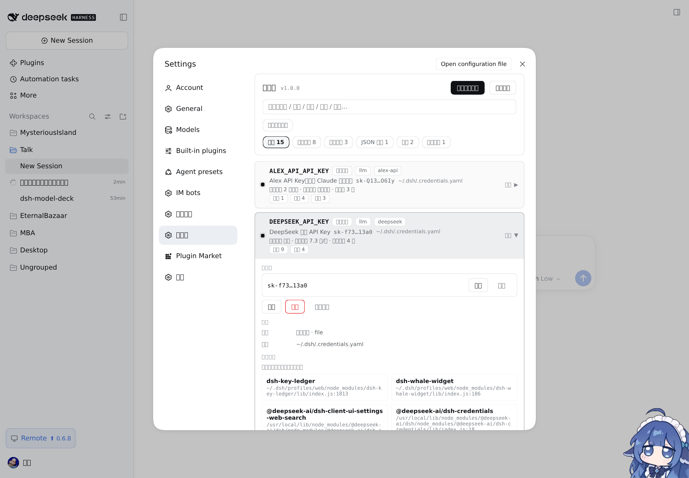
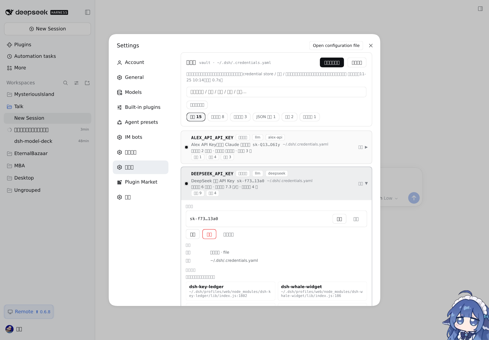

# 钥匙簿 · dsh-key-ledger

把这一台 DSH 里**散落各处的密钥与凭据**收拢成一本账：值留在原处，账在这里。



## 它解决什么

密钥通常同时躺在四五个地方，彼此不知道对方：

| 位置 | 例子 |
|---|---|
| credential store（`~/.dsh/.credentials.yaml`） | `refs` 里的 `DEEPSEEK_API_KEY`；`records` 里的授权 |
| 启动环境 / `.env` | `DEEPSEEK_API_KEY=… dsh`、项目 `.env` |
| 插件自己的文件 | `~/.dsh/ssh/id_ed25519`、`~/.dsh/certs/*.pem`、网关 api-key |
| JSON 账号存储 | 微信 bot 的 `state.json`、第三方 cookie |
| 明文写在配置里 | `cordis.patch.yml` 里的 `apiKey: sk-…`（危险） |

钥匙簿把这五类都找出来统一列出：**类型、来源、掩码值、谁用过、用了几次**，
并支持查看、修改、删除。它**不复制秘密** —— 值永远留在原来的权威位置，
插件只持久化注记、标签、访问日志和引用索引。

## 关键能力

- **谁在用它**：插件包、技能、配置引用（带 `file:line`）、**用过的会话**（名称 + 最近时间 + 次数）。
- **首次安装自动扫描**：装好即自动扫描已有会话建立索引，**跳过归档会话**；之后可手动重建。
- **使用统计**：最近一次使用、平均频率、近 7/30 天次数（「取用」与「会话引用」分开算，不混为一谈）。
- **删除即生效**：删掉的凭据留墓碑，来源再出现也不自动复活；`.bak` 只给你自己回滚用。
- **统一取用入口**：注册常驻系统提示纪律，agent 取任何密钥都走 `vault` 工具并留痕。



## 能改什么、不能改什么

| 类型 | 改 | 删 |
|---|---|---|
| credential store 的键 | ✅ 写回 store，下个请求即生效 | ✅ |
| 授权记录（`<owner>/<id>`） | 由宿主插件解释，只读 | ✅ |
| `.env` 里的项 | 只读 | ✅ 删那一行 + 备份 |
| 文件型（私钥 / 证书 / api-key） | ✅ 原地改，自动 `.bak` | ✅ |
| JSON 字段（token / cookie） | ✅ 改字段，先备份整文件 | ✅ |
| 启动环境变量 | 只读（启动快照） | ❌ 给「移出列表」 |
| 明文配置 | 只读，标红风险 | ❌ 给「移出列表」 |

## agent 怎么取密钥

```
vault { action: "list" }                                  # 有哪些（只给掩码）
vault { action: "describe", name: "DEEPSEEK_API_KEY" }    # 被谁用过
vault { action: "get", name: "DEEPSEEK_API_KEY", reason: "调用 DeepSeek 接口" }
vault { action: "set", name: "MY_KEY", value: "…" }        # 新增或轮换
vault { action: "delete", name: "MY_KEY", confirm: true }
vault { action: "scan" }                                  # 重建引用索引
```

## 安装

```bash
dsh plugin --profile <profile> add github:Sakura7301/dsh-key-ledger
```

安装后在**设置 → 钥匙簿**里使用。首次打开会自动扫描已有会话建立索引（归档会话不计）。

## 限制（如实写）

- 列表只下发掩码，明文仅在显式「显示」时下发（60 秒自动隐藏），每次取用都记访问日志。
- 「取用」= 经本插件的真实调用；LLM 适配器内部解析密钥的瞬间**没有事件可挂**，那部分不会自动出现在日志里。
- 「会话引用」= 会话记录里出现过该标识，只是痕迹，不等于调用。
- 引用索引有预算上限（字节数 + 时间），超出会截断。

详细设计与边界见 [docs/DETAIL.md](docs/DETAIL.md)，Docker 持久化见 [docs/DOCKER.md](docs/DOCKER.md)。

## 许可

BSD-3-Clause。
